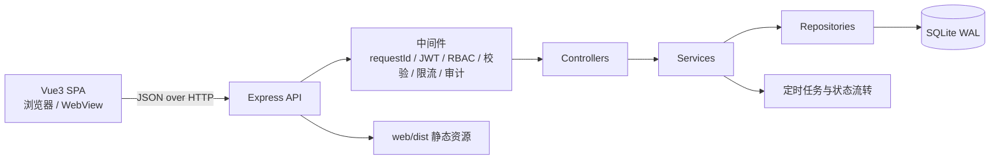
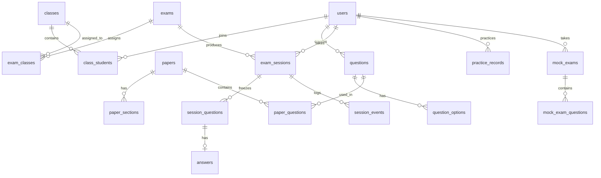

# 系统设计说明

## 1. 项目概述

在线考试与题库系统，支持管理员、教师、学生三种角色。

核心能力：

- 题库：五种题型、知识点、难度、CSV 导入导出
- 组卷：手动组卷与按策略随机组卷，发布时冻结题目快照
- 考试：时间窗、班级指派、状态机、题目与选项乱序
- 答题：自动保存、断线续考、超时自动交卷、防作弊事件
- 阅卷：客观题自动判分、主观题人工评分、成绩合成
- 统计：成绩单、排名、题目正确率、知识点掌握度、CSV 导出
- 学生练习：随机练习、即时判分、错题本、主观题自评、错题重做
- 模拟考试：学生自主组卷、限时答题、交卷即时出分
- AI 学习监督接口（预留，默认关闭）

## 2. 技术选型

| 层 | 选择 | 理由 |
|---|---|---|
| 运行时 | Node.js 24 + Express 4 | 环境轻量，部署只需 Node |
| 数据库 | SQLite（Node 内置 `node:sqlite`） | 零原生依赖、无需安装数据库服务、便于离线演示 |
| 鉴权 | JWT + bcryptjs | 无状态、纯 JS 依赖 |
| 校验 | Zod | 统一的请求参数校验 |
| 前端 | Vue3 + Vite + Vue Router（hash）+ Pinia + Element Plus + ECharts | 浏览器渲染、WebView 兼容、图表能力 |
| 测试 | Node 内置 `node:test` + supertest | 不引入额外测试框架 |

**为什么不用 better-sqlite3**：本机访问 GitHub release 不稳定，原生模块安装风险高；Node 内置 `node:sqlite` 已满足需求。

## 3. 系统架构



分层约定：`routes → controllers → services → repositories → db`，不允许跨层调用。

- routes 只负责挂载与路由匹配
- controllers 只取参数、调用 service、返回统一响应
- services 承担业务规则、权限归属、事务边界
- repositories 只写 SQL
- 统一响应：`{ success, message, data }`
- 统一错误：`AppError` + 中间件兜底，SQLite 约束错误映射为 409/422

## 4. 目录结构

```text
server/src/config        配置与常量
server/src/db            连接、迁移、种子（含英语题库）
server/src/utils         工具函数（JWT、密码、CSV、归一化等）
server/src/middleware    鉴权、RBAC、校验、限流、审计、错误处理
server/src/validators    Zod 请求校验
server/src/repositories  数据访问层
server/src/services      业务逻辑层
server/src/controllers   HTTP 控制器
server/src/routes        路由
server/tests             单元与集成测试
web/                     Vue3 前端
docs/                    设计、测试、演示、开发日志
```

## 5. 数据模型

### 5.1 核心表

- 用户与组织：`users`、`classes`、`class_students`
- 题库：`questions`、`question_options`、`knowledge_points`、`question_knowledge_points`
- 试卷：`papers`、`paper_sections`、`paper_questions`
- 考试：`exams`、`exam_classes`
- 答题：`exam_sessions`、`session_questions`、`answers`、`session_events`
- 阅卷：`grading_reviews`
- 练习：`practice_records`
- 模拟考试：`mock_exams`、`mock_exam_questions`
- 运维：`notifications`、`audit_logs`、`system_configs`、`job_runs`
- 监督接口：`supervisor_events`

### 5.2 ER 图（核心关系）



### 5.3 双快照设计

1. **试卷发布快照**：`paper_questions.snapshot_json`，冻结题干、选项、答案、解析、知识点。
2. **考试会话快照**：`session_questions.question_snapshot_json`，冻结本场题目顺序与选项顺序。

这样发布后修改题库不会影响已发布试卷，考试进行中修改题库也不会影响正在作答的学生。答案只关联 `session_question_id`，判分不读取实时题库。

## 6. 关键设计

### 6.1 考试状态机

```text
draft → scheduled → ongoing → finished → published
```

- 排期后按时间窗惰性流转：查询/开考时自动把 `scheduled` 推进为 `ongoing`，超时推进为 `finished`
- 状态迁移使用条件更新，避免并发重复流转
- 结束考试与发布成绩由教师显式操作

### 6.2 时间与超时

- 所有时间以毫秒时间戳存储，服务端计算，绝不相信前端倒计时
- 截止时间：`deadline = min(开考时间 + 时长, 考试结束时间)`
- 访问答题接口时若已超时，服务端自动交卷
- 自动保存采用 UPSERT + `save_version` 递增

### 6.3 判分

- 单选/多选/判断/填空自动判分
- 多选题与顺序无关；填空题支持 `|` 分隔同义答案与多空
- 简答题不自动判分，由教师人工评分
- 阅卷完成时：`总分 = 客观分 + 主观分`，会话状态改为 `graded`

### 6.4 防作弊

- 前端采集：失焦、页面隐藏、复制、粘贴、退出全屏
- 上报时带 `client_seq`，服务端唯一约束去重
- 会话记录 `violation_count`，阅卷与统计中可见

### 6.5 练习与错题本

- 练习只出客观题，提交后即时返回对错、正确答案与解析
- 主观题练习：提交后返回参考答案，由学生自评「掌握 / 还需练」
- 错题本以「每道题最近一次作答」为准：最近一次答对自动移出，历史记录保留
- 错题重做支持单题与全部，只出客观题

### 6.6 AI 学习监督接口（预留）

- 只读接口：学习概览、考试记录、事件队列
- 默认关闭（`SUPERVISOR_ENABLED=false`），启用需要 `x-supervisor-key`
- 交卷/阅卷写入事件，系统**不主动外发任何请求**
- 详见 `docs/SUPERVISOR_API.md`

## 7. API 概览

| 前缀 | 说明 | 角色 |
|---|---|---|
| `/api/auth` | 登录、当前用户、改密码 | 公开 / 登录用户 |
| `/api/users` | 用户管理 | 管理员（学生列表教师可读） |
| `/api/classes` | 班级与成员 | 管理员、教师、学生（只读自己的） |
| `/api/knowledge-points` | 知识点树 | 登录用户读，教师/管理员写 |
| `/api/questions` | 题库、导入导出 | 教师、管理员 |
| `/api/papers` | 试卷、组卷、发布 | 教师、管理员 |
| `/api/exams` | 考试计划、排期、结束、发布 | 教师、管理员 |
| `/api/student` | 学生考试、答题、交卷、成绩 | 学生 |
| `/api/grading` | 阅卷、评分、合成 | 教师、管理员 |
| `/api/stats` | 统计、排名、分析、导出 | 教师、管理员 |
| `/api/practice` | 练习、统计、错题本、自评 | 学生 |
| `/api/mock-exams` | 学生模拟考试 | 学生 |
| `/api/supervisor` | 外部学习助手（预留） | API Key |

## 8. 权限模型

- JWT 载荷包含用户 ID、角色、令牌版本
- 每次请求从数据库加载用户，检查状态与 `token_version`；改密码/禁用账号后旧令牌立即失效
- RBAC 中间件按路由限制角色
- 数据归属：教师只能操作自己创建的试卷、考试与题目；管理员不受限

## 9. 部署形态

- 前端 `npm run build` 产出 `web/dist`
- Express 同时托管静态资源与 `/api`，单端口运行
- SQLite 文件位于 `data/exam.db`，WAL 模式
- 启动时自动执行数据库迁移
- 前端使用 hash 路由与相对路径，可直接放进 WebView

## 10. 已知边界

- 听力题需要音频存储与播放，当前不支持
- 简答题不自动判分
- 练习与模拟考试只包含客观题
- 教师端「试卷管理/考试管理」页面尚未实现（后端接口已完成，可通过接口或种子数据创建）
